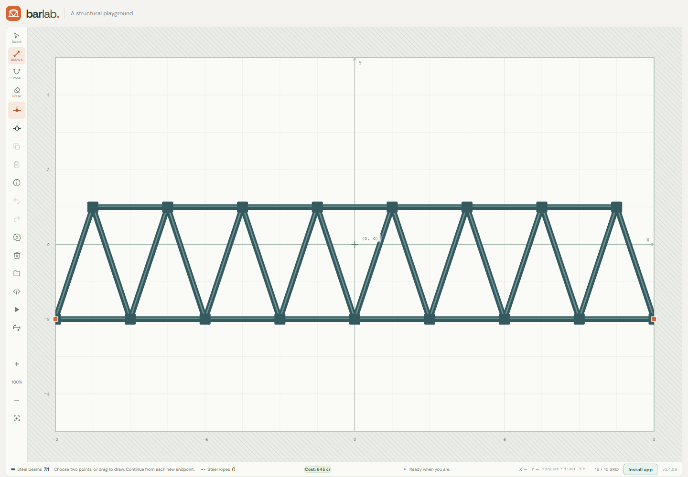
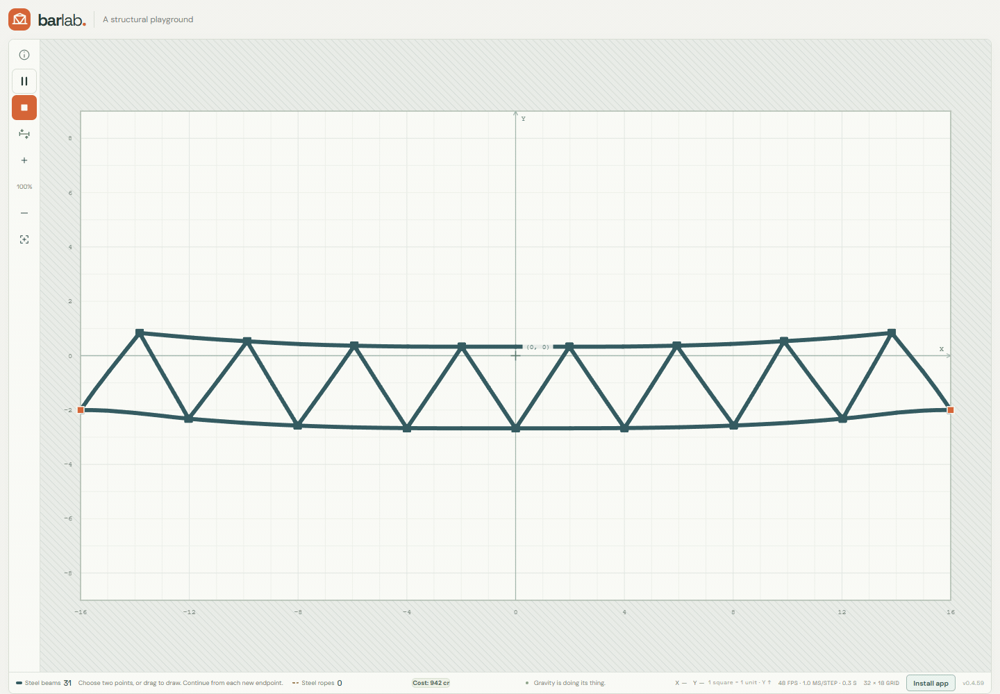

# Bar Lab

Bar Lab is a browser-based structural playground. Build with elastic steel beams and tension-only ropes, then test your design under gravity. No download or account is needed to play.

**[Play Bar Lab](https://barlab.jakubreiter.pl/)** · [Player guide](docs/user-guide.md) · [Development guide](docs/development.md)

[Solver algorithms](docs/solvers/README.md): [Basic XPBD Solver](docs/solvers/original.md) · [Serpentine](docs/solvers/serpentine.md). Includes labelled diagrams, worked calculations and simulation animations.

## Features

- Draw structures with three beam profiles and tension-only ropes.
- Select and move groups, copy them for repeated pastes, and reflect copies left–right or up–down.
- Run a physics simulation and inspect relative stress.
- Save designs in the browser or copy project text to share and back up.
- Install the Progressive Web App for a full-screen experience and offline play.

## Contributing

See [CONTRIBUTING.md](CONTRIBUTING.md) for the contribution workflow and [docs/development.md](docs/development.md) to set up the project.
