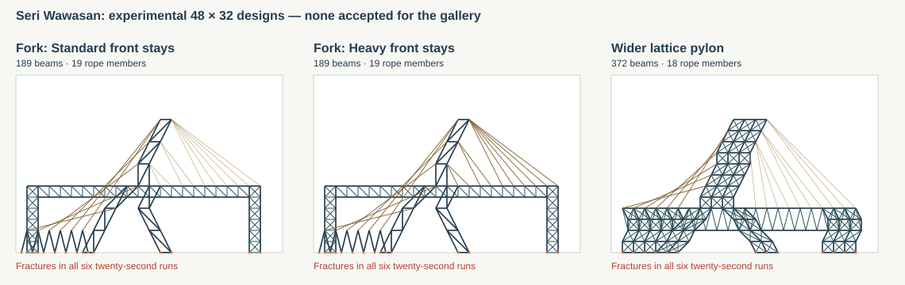

# Larger Seri Wawasan: rejected stability trials

The requested larger replacement **has not passed acceptance and is not in the gallery**. The gallery keeps the existing 24 × 14 design and its documented limitations. No application geometry, material, gravity, iteration count, initial imperfection, project format or game version was changed in this experiment.



*Unloaded design geometry, in editor coordinates with Y downward. Orange dots identify the actual ground-support endpoints. These are failed experimental models, not previews of a stable replacement.*

## Geometry and inspiration

The reference is the inclined, asymmetric pylon, forward cable fan and crossing rear stay network described in [CIDB's Beautiful Bridges](https://www.cidb.gov.my/wp-content/uploads/2022/11/CIDB-full-layout-12.54pm-lowres_compressed.pdf). Each candidate uses a 48 × 32 board, ten front stays and six rear stays. Longer stays are segmented; member counts therefore exceed sixteen. Cable crossings without a shared endpoint do not create joints.

The two fork variants have a 42-unit-long deck instead of the current example's 24-unit deck, and a pylon extending from Y = 32 to Y = 8. Visible lattice bank frames and split pylon legs transfer loads to the bottom boundary; the candidates have no side-wall or ceiling supports. The rear tie frames reach Y = 28 from actual ground foundations. These raised frames are explicit simplifications, not hidden anchors. The upper pylon leans toward the main span.

The third candidate uses a wider, more heavily triangulated pylon and broader fork legs. Its deeper deck and denser bank frames are deliberate visible stiffening. The fork variants differ only in the front-stay profile, allowing the effect of extra cable mass and axial rigidity to be compared directly. The wider lattice uses Standard front stays and Heavy rear stays.

| Candidate fixture | Beams | Rope members | Front / rear profiles |
| --- | ---: | ---: | --- |
| [Fork: Standard front](fork-standard-front.json) | 189 | 19 | Standard / Heavy |
| [Fork: Heavy front](fork-heavy-front.json) | 189 | 19 | Heavy / Heavy |
| [Wider lattice](wide-lattice.json) | 372 | 18 | Standard / Heavy |

All three fixtures use format 4 and pass the same geometry, overlap, bounds, length-limit and exact import/export round-trip checks as the gallery examples. Beams remain at most six units long and ropes at most twenty. The diagram is generated from their saved geometry.

## Full twenty-second measurements

Every candidate was run for 2,400 steps, even after failure, with Basic XPBD, left-start Serpentine and right-start Serpentine. Each schedule used both +0.001 and −0.001 perturbations: **18 complete trajectories**. All acceptance runs use gravity 9.81, 12 iterations, DT = 1/120 and the existing material properties. Every particle is checked at initialization and after every step.

Acceptance requires no fractures, peak displacement at most 2.5 units, exactly stationary support particles, finite state, and no new contacts with any board boundary. Initial ground contacts at real foundations are allowed.

| Candidate | Passing runs | Earliest–latest first fracture | Worst displacement | Broken members at 20 s | New boundary contacts |
| --- | ---: | --- | ---: | ---: | --- |
| Fork: Standard front | 0 / 6 | 0.692–0.975 s | 25.135 | 15–32 | All six runs |
| Fork: Heavy front | 0 / 6 | 0.700–0.967 s | 25.021 | 17–34 | All six runs |
| Wider lattice | 0 / 6 | 0.450–0.758 s | 25.445 | 40–100 | All six runs |

All support particles remained exactly fixed, and all trajectories remained finite. Large displacement and boundary contacts occur after the first structural failures; they are not successful load paths. Exact values are in [measurements.json](measurements.json).

Exploration also varied pylon height and inclination, two- versus four-unit lattice panels, two- to four-unit deck depth, bank width, independent front/rear rope profiles and joint alignment. Short screening runs stopped at the first violated criterion. Those screens are not included as complete acceptance trajectories, and the saved three-candidate matrix is not claimed to exhaust every possible geometry.

The existing four gallery measurement sets were rerun unchanged. Ponte Luís I, Kołowo and Golden Gate still pass all six variants; the current small Seri Wawasan retains its 3.393-unit peak and two left-start fracture runs. Their results remain in [the gallery report](../measurements.json). No exception was removed from the existing Seri Wawasan tests, and no thumbnail, canvas size or gallery count was changed because the replacement gate was not met.

## Diagnosis and concrete follow-up proposal

A separate 0.6-second sensitivity check examined the translational welds that are supposed to keep member endpoints coincident. It used the Standard-front fork before its first fracture. With the normal 12 iterations, the maximum endpoint-copy separation reached 0.067 units in Basic XPBD and 0.163 in right-start Serpentine. At 96 diagnostic iterations those gaps decreased to 0.017 and 0.065, respectively. These 96-iteration checks are **not acceptance runs**, did not change the app, and do not establish a stable twenty-second model. Exact data are in [joint-diagnostics.json](joint-diagnostics.json).

The nonzero joint gaps show a numerical contribution to deformation, but do not prove that it is the sole cause of failure. Increasing Heavy-beam cross-sectional area in separate short exploratory checks also failed to produce an acceptable candidate; more mass can overload the remaining Standard webs. Neither a larger canvas nor a stronger label is a demonstrated fix.

**Proposed separate follow-up, not implemented:** represent each intact translational weld with a shared positional degree of freedom rather than several endpoint particles connected by an iterated zero-length constraint. Sum incident particle masses at a shared node, preserve the real fixed/pinned foundation rules and existing member elasticity, and split the relevant degrees of freedom when a midpoint weld fractures. Retain the twelve sweeps for the remaining elastic and angular constraints. Prototype this generically for every project, then rerun this candidate matrix and all existing examples before considering gallery integration.

That proposal removes an observed source of artificial joint opening without changing gravity, suppressing damage, adding invisible supports or introducing rope pretension. It is an accuracy/topology change beyond the approved geometry-only scope and needs a separate decision. It is a concrete next experiment, not a claim that the larger bridge is now stable.

## Reproduction

From the project root:

```powershell
node --import tsx scripts/measure-seri-wawasan.ts
node --import tsx scripts/measure-landmarks.ts
npm test
$env:FRAME_LAB_CHROMIUM = 'C:\Program Files\Google\Chrome\Application\chrome.exe'
npm run test:browser
```

The first command regenerates the rejected-candidate report from the three checked-in JSON designs. The second refreshes the gallery measurements. Passing the application's regression suite does not change any failed candidate into an accepted design.
