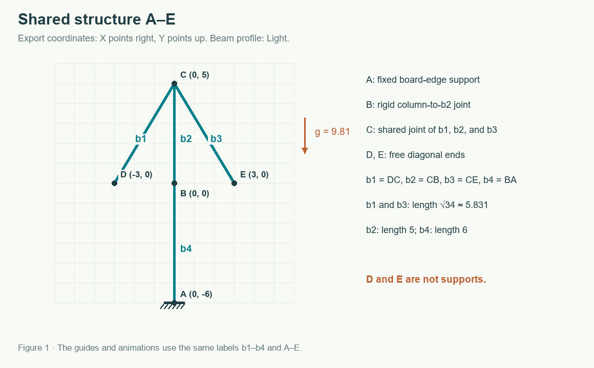

# Solver Algorithms

Bar Lab offers two simulation solvers. [Basic XPBD Solver](original.md) preserves the original constraint order. [Serpentine](serpentine.md) changes the order of local corrections and is selected when the app opens. Choose either solver in Settings; the choice lasts until the page reloads.

| Solver | Order of corrections | Relative stress indicator | Detailed guide |
| --- | --- | --- | --- |
| Basic XPBD Solver (original) | Constraint creation order, alternating forward and reverse passes | Axial strain and curvature | [Basic XPBD Solver](original.md) |
| Serpentine | Top-down serpentine scan, with a randomly chosen starting side | Same strain measures as Basic XPBD Solver | [Serpentine solver](serpentine.md) |

Both use the same particle model, fixed time step, material profiles, and local XPBD corrections.

Since 0.4.76, both solvers start each run with a small, deterministic horizontal imperfection of at most 0.001 board units. It is applied once, preserves coincident joint particles and boundary supports, and leaves the saved design unchanged. The iteration count remains 12. Identical geometry receives the same disturbance regardless of the solver or Serpentine starting side.

For diagnostics, `PhysicsOptions.initialPerturbation` controls the signed amplitude: the default is `0.001`, a negative value tests the opposite direction, and `0` disables it. At initial internal coordinates `(x, y)` on a board of width `W` and height `H`, the horizontal offset is `amplitude × sin(πx/W) × sin(πy/H)`; boundary points remain exactly fixed. The historical trajectories below explicitly disable this imperfection to retain their original comparison of correction orders.

## Stability and exact symmetry

See [Stability, Symmetry, and Iteration Count](stability.md) for an illustrated comparison of a braced column that leans and an unbraced column that appears stable. The measured example separates incomplete solver convergence from exact vertical symmetry hiding sensitivity to a lateral disturbance.

## Shared example and labels

The shared tower and measured solver trajectories are retained in [measurements.json](measurements.json). The example demonstrates sensitivity to correction order; it does not rank solver accuracy. Randomizing the Serpentine starting side does not guarantee mirror symmetry or stability.

## Animations and reproduction

- [Basic XPBD Solver animation and explanation](original.md#animation).
- [Serpentine animation showing both starts](serpentine.md#animation).

~~~powershell
node --import tsx scripts/generate-solver-docs.ts
python scripts/render-solver-docs.py
~~~

Run both commands from the project root. Rendering requires Python 3, Pillow, and either Arial on Windows or DejaVu Sans on Linux. The first script checks the numerical distance-correction example and records measurements. The second renders the labeled PNG and GIF files in docs/images/solvers/.

Implementation: [model and profiles](../../src/model.ts), [World and XPBD](../../src/physics.ts), [Serpentine ordering](../../src/solver-strategies.ts), [worker](../../src/simulation.worker.ts).

[User guide](../user-guide.md) · [Development guide](../development.md)
