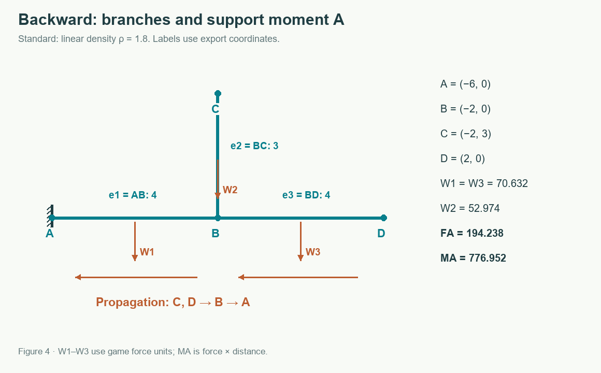
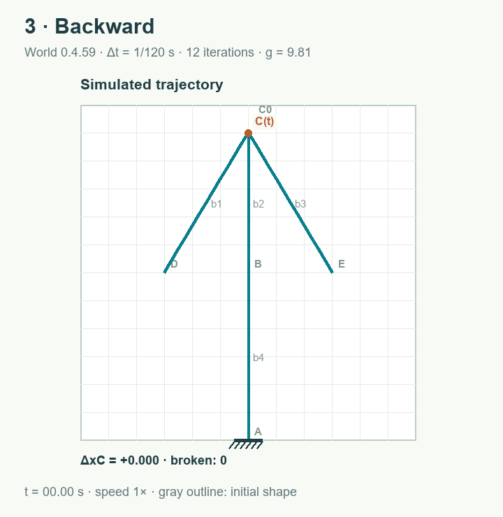

# Backward — Load Propagation from Branches to Supports

[All solvers and labels A–E](README.md) · [Basic XPBD Solver](original.md) · [Serpentine](serpentine.md)

Backward estimates the weight and moment carried by each branch. It then corrects local constraints from remote branches toward supports and makes a return pass. It remains a dynamic particle-based XPBD solver. Its load propagation is a gravity-based approximation; it does not solve a global stiffness matrix or a complete balance of inertia and contact forces.

## 1. Build the graph and support layers

Graph vertices are physics particles, not merely visible beam endpoints. Edges come from distance constraints: beam and rope segments, midpoint welds, and welds between coincident endpoints. Angle constraints do not add graph edges.

Every particle with zero inverse mass is a root at depth 0. Breadth-first search (BFS) assigns successive depths to its neighbors. Depth counts edges, not path length in board cells, so segmentation and midpoint welds affect the layers.

A particle's parents are all neighbors exactly one layer closer to a root. Particles in a component without a support retain depth −1 and receive no invented static support reaction. They still move under dynamic XPBD.

In a tree, each branch has one route to its root. For a structure with loops, the layers form a directed acyclic graph of routes toward supports. An edge between particles in the same layer is omitted from the static estimate but still solved dynamically. Consequently, the estimate is not a complete solution for a statically indeterminate frame.

## 2. Propagate force and moment

For each particle i, the initial values are:

~~~text
Fi = mi g
Mi = 0
~~~

Fi is a scalar vertical force, positive along the internal downward Y axis. The algorithm walks from the deepest layer toward the supports. For child **c**, parent **p**, and load share s:

~~~text
f = s Fc
m = s Mc + (xc − xp) f
Fp ← Fp + f
Mp ← Mp + m             // only if the connection transmits moment
~~~

The term (xc − xp) f is the moment of the vertical force about the parent's horizontal position. Gravity is not added again at the child: its own mi g and contributions from descendants are already in Fc. On a tree, this counts each mass exactly once in the root reaction.

A hinge between beams transmits force but releases the accumulated moment. A hinged support has zero estimated reaction moment. Ropes transmit no moment, and a route requiring a rope to carry compression is excluded. The acceptance condition for a rope route is Fc × (yc − yp) > 0. Shares of the remaining routes are then renormalized.

That rope test applies to the vertical gravity estimate. Dynamic rope motion and tension still come from unilateral XPBD constraints rather than a full force vector from this approximation.

## 3. Worked branch example e1–e3

This figure is a **separate project** from tower A–E. Here **A = (−6, 0)** is a fixed support on the left, **B = (−2, 0)** is the branch point, **C = (−2, 3)** ends the vertical branch, and **D = (2, 0)** ends the right branch. The members are **e1 = AB**, **e2 = BC**, and **e3 = BD**. All use the Standard profile and rigid connections.

The linear density is ρ = 1.8, so:

| Member | Length | Mass ρL | Weight W = ρLg | Horizontal center-of-mass arm from A |
| --- | ---: | ---: | ---: | ---: |
| e1 | 4 | 7.2 | W1 = 70.632 | 2 |
| e2 | 3 | 5.4 | W2 = 52.974 | 4 |
| e3 | 4 | 7.2 | W3 = 70.632 | 6 |

Branches e2 and e3 reach B from different directions. Their weights travel toward A through e1. The total weight is:

~~~text
FA = W1 + W2 + W3
   = 70.632 + 52.974 + 70.632
   = 194.238
~~~

Initially, vertical e2's own weight creates no moment about B. Beam e3 creates W3 × 2 = 141.264 about B. Bringing all contributions to A gives:

~~~text
MA = W1 × 2 + W2 × 4 + W3 × 6
   = 141.264 + 211.896 + 423.792
   = 776.952
~~~

In the actual graph, these operations are distributed over segments and welds. Half of each segment's mass is assigned to each endpoint particle. For initially straight beams of uniform density, this preserves both total mass and its first moment. Particle sums therefore produce the same FA and MA. FA also includes the root particle's own weight; that is not an extra force transmitted to the root through one segment.

The [documentation data generator](../../scripts/generate-solver-docs.ts) checks FA and MA numerically with tolerance 10⁻⁹. The values are derived from the implementation rather than inserted independently into the animation.

## 4. Split loads among several support routes

When a child has several parents one layer closer to supports, their initial shares are proportional to stiffness weights:

~~~text
ki = profile axial stiffness KA for a beam segment
   = 80,000 for a rope segment
   = 1 for a weld between members
si = ki / Σ kj
~~~

For example, two routes through Standard and Light segments have k1 = 2,000,000 and k2 = 1,000,000. Thus s1 = 2/3 and s2 = 1/3, and a load of 90 splits into 60 and 30. If both routes transmit moment, the child's accumulated moment splits in the same proportions; each route then adds the moment of its own horizontal arm.

These weights are a simplification. They do not account for the global compliance of entire paths or solve displacement compatibility across all loops. A weld's weight of 1 in this estimate does not change its physical XPBD compliance: it remains a rigid position constraint.

## 5. Relative stress estimated from load

On a segment between child and parent, the algorithm projects the vertical load contribution f onto the segment direction:

~~~text
N = f (yc − yp) / segment_length
beam_axial_indicator = |N| / (KA × 0.10)
rope_axial_indicator = max(0, N) / (80,000 × 0.10)
bending_indicator = |m| / (KB × 0.95 × curvature_multiplier)
~~~

Segments of nearly zero length receive no axial projection. Moment is evaluated only on links that transmit it. The maximum indicator over segments supplies the estimate for each member.

For **e1**, the Standard profile has KB = 10,000 and curvature multiplier 1. From the initial moment at A:

~~~text
bending_indicator_e1 = 776.952 / (10,000 × 0.95 × 1)
                     ≈ 0.081784421
~~~

This is 8.18% of the game's nominal limit. The generator reads this value directly from BackwardTree.stresses[0]. Compression dominates e2, while a smaller local moment affects e3; their indicators are in [measurements.json](measurements.json). As the structure deforms, the moment arms and indicators can change.

## 6. Use the estimate during simulation

At the start of each step, forces and moments are updated. Constraints are sorted first by the greatest depth of their particles, descending, then by |Fa| + |Fb|, also descending. Here a and b are the first particle pair of a constraint; an angle constraint also considers the depth of its second pair. Ties retain creation order.

The first pass therefore runs from remote branches toward supports; traversing the list in reverse on the next pass sends corrections back out. There are still 12 iterations, with distance corrections before angle corrections. Tree forces are not applied again as accelerations, because gravity already acts during XPBD motion prediction.

After position correction, loads are estimated again for the current geometry. The final relative stress is the maximum of:

1. Axial and angular deformation, as in Basic XPBD Solver.
2. Axial load and moment indicators from Backward propagation.

This indicator controls stress color and the overload timer. The breaking rule remains stress > 1 for 0.05 s. A break disables the midpoint weld; before the next estimate, the changed topology triggers a rebuild of layers and parents.

## Animation

For comparison, this animation uses the shared **tower A–E with b1–b4**, not the separate branch example e1–e3. After 5 s, **C(t)** has ΔxC ≈ −0.396398; after 10 s, it has −5.993729. No beam breaks by 12 s. Neither backward ordering nor the load estimate guarantees symmetry or stability for this tower.

The static estimate does not add contact supports when a beam touches the floor or a wall. Inertia and contact reactions are absent from the tree. The shared dynamic solver still confines positions to the board and measures deformation. In structures with many loops, interpret the propagated loads as approximate support routes.

Implementation: [BackwardTree](../../src/solver-strategies.ts) and [constraint ordering and indicator combination](../../src/physics.ts). [Physics tests](../../tests/physics.test.ts) cover cantilever weight and moment, hinges, rope compression, multiple supports, cycles, unsupported components, and fracture.
