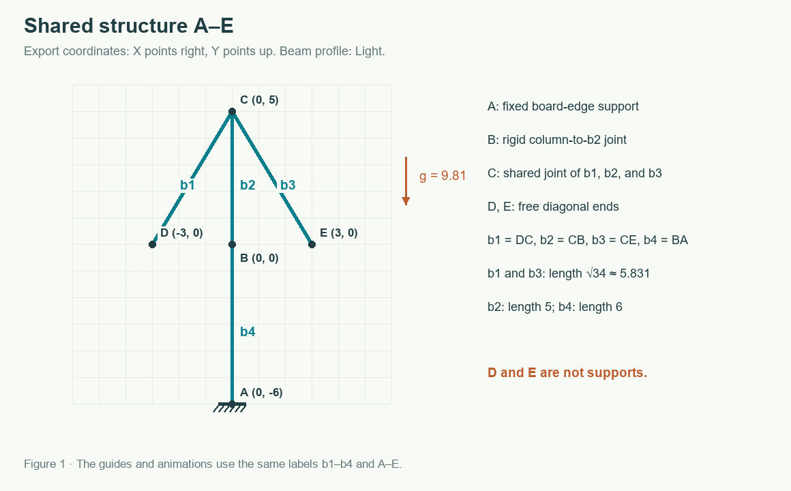
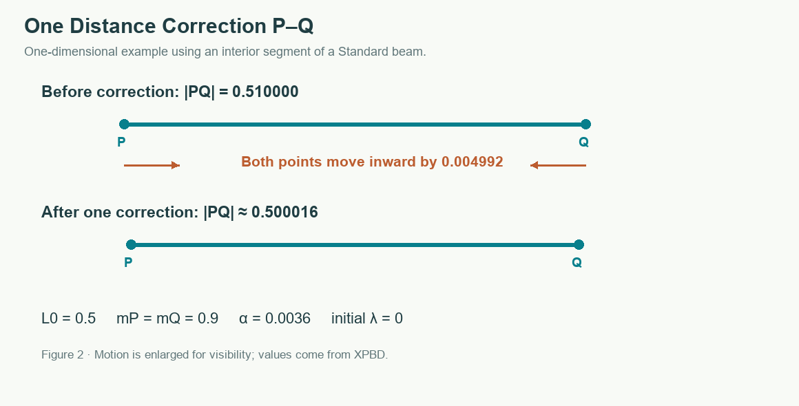
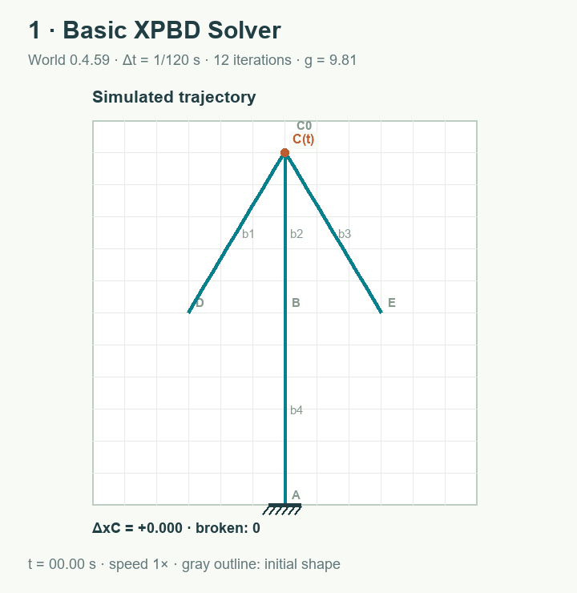

# Basic XPBD Solver — Local XPBD Corrections

[All solvers and labels A–E](README.md) · [Serpentine](serpentine.md)

Basic XPBD Solver (internal ID: original) retains the game's established constraint order. It uses extended position-based dynamics (XPBD): instead of finding the global equilibrium of the whole structure at once, it repeatedly adjusts particle positions to satisfy length and angle constraints. Neighboring corrections affect one another, so a finite iteration count leaves some dependence on processing order.

In the shared example, **b1 = DC**, **b2 = CB**, **b3 = CE**, and **b4 = BA**. Support **A** fixes the end of b4 and the direction of its first segment. **D** and **E** are free.

## 1. Convert beams to particles and constraints

For a beam of length L, the initial segment count is n = max(4, ceil(L / 0.5)); an odd n is increased by one. Each segment has length h = L/n. The beam consists of two halves, each containing n/2 + 1 particles. Two rendering samples coincide at the midpoint and address one physical particle. Breaking the beam splits that particle into independent half-member tips and disables the central angle constraint.

For example, **b4** has L = 6, n = 12, h = 0.5, and 14 rendering samples representing 13 physical particles before fracture. Each half contains seven samples. A segment contributes half of its mass, ρh/2, to each endpoint. For the Light profile, ρ = 0.9, so each segment contributes 0.225 to each endpoint; an ordinary interior particle has mass 0.45.

Connected endpoints share one physical particle. At **C**, the end of b1 and the starts of b2 and b3 use the same position, velocity and summed mass. Because C is rigid, angle constraints also preserve each beam's angle relative to the first beam, b1 in the Basic XPBD order. Hinges share translation in exactly the same way, but omit those angular constraints. See [Shared Positional Points](shared-point.md).

## 2. Predict motion under gravity

Before applying constraints, the solver stores the old positions and updates each movable particle:

~~~text
q = exp(−d Δt) ≈ 0.994598
vx ← q vx
vy ← q vy + g Δt
x ← x + vx Δt
y ← y + vy Δt
~~~

Here Y increases downward. For a particle initially at rest, vy = 9.81/120 = 0.08175, giving an unconstrained first-step drop of 0.08175/120 = 0.00068125 board cells. Particles fixed by support **A** have zero inverse mass and do not move in this prediction.

## 3. Correct length: the P–Q example

In this separate example, **P** and **Q** are movable interior particles of a **Standard** beam. Each has mass 0.9. Their rest distance is L₀ = 0.5, and their current distance is |PQ| = 0.51. Assume λ = 0 at the start of the step.

~~~text
C = |PQ| − L₀ = 0.01
compliance = h / KA = 0.5 / 2,000,000 = 0.00000025
α = compliance / Δt² = 0.0036
wP = wQ = 1/0.9 ≈ 1.111111
Δλ = (−C − αλ) / (wP + wQ + α)
   = −0.01 / (2.222222… + 0.0036)
   ≈ −0.004492722
~~~

The unit vector from P to Q points right in the figure. The correction moves **P** right by −wP Δλ ≈ 0.004991913 and **Q** left by the same amount. Their new distance is:

~~~text
0.51 − 2 × 0.004991913 ≈ 0.500016174
~~~

A small extension remains after one correction because the constraint has nonzero compliance. λ accumulates across iterations within a step and is reset before the next physics step. Each correction also changes the inputs to neighboring constraints; the constraint is not an independent animation spring.

A rope uses a similar distance correction, but does nothing when freely shortened. Its λ is restricted to the tension-producing range, so it does not exert compression.

## 4. Correct angles and iterate

Internal angle constraints keep beam segments collinear. Their compliance is h/KB. At a rigid joint such as **C**, the initial angle between beams is preserved with zero compliance. A hinge receives no inter-beam angle constraint. A fixed support such as **A** preserves the direction of the end segment; a hinged support preserves position only.

The angle correction uses the same form for Δλ, with denominator Σ wi |∇i C|² + α. The gradient describes how moving each particle changes the angle. The shared particle of adjacent segments receives the sum of both gradient contributions, so it is not treated as two independent particles.

Each physics step has 12 iterations:

1. Iterations 0, 2, …, 10 process distance constraints in creation order, then angle constraints in creation order.
2. Iterations 1, 3, …, 11 reverse each list. Distances still precede angles.
3. After every iteration, positions are confined to the board rectangle and support positions are restored exactly.

Constraint creation starts with the project's beams, then ropes, joints, and supports. Import first normalizes element directions and sorts the elements. Alternating list direction reduces, but does not eliminate, the bias caused by order.

## 5. Relative stress and breaking

After the iterations, velocity is reconstructed from displacement: (new position − old position)/Δt. A beam's axial indicator is |(|PQ| − L₀)/L₀| / 0.10. For a rope, only positive extension counts. The bending indicator is |θ| / h / (0.95 × curvature-limit multiplier). The largest value over segments and angles becomes the member's relative stress.

For example, a Light beam with local angle θ = 0.05 rad and h = 0.5 has bending indicator (0.05/0.5)/(0.95 × 1.4) ≈ 0.075188, or 7.52% of the game's bending limit. It is not a measure of real steel strength.

An indicator greater than 1 for at least 0.05 s breaks the member. At Δt = 1/120 s, that is six consecutive steps. A return to 1 or below resets the overload timer. A large overall lean need not break a beam if its local limits are not exceeded.

## Historical animation

The animation and values in this section predate the 0.5.0 shared-particle change. They are retained as historical measurements, not current trajectory predictions.

After 5 s, **C(t)** has ΔxC ≈ −0.519741; after 10 s, it has ΔxC ≈ −5.995179. None of b1–b4 breaks by 12 s. A small numerical asymmetry grows while gravity loads the slender column B–A. Identical starting conditions give an identical trajectory because this solver does not randomize order.

Increasing the iteration count changes the effective response of the structure. Neither the direction nor the time of collapse should be treated as a precise stability-analysis result. See the [comparison and measurements](README.md#comparison-of-simulated-results).

For a measured comparison of braced and unbraced columns, see [Stability, Symmetry, and Iteration Count](stability.md).

Implementation: [World, solveDistance, solveAngle, step, and measureDamage](../../src/physics.ts). Current topology, mass, angular-gradient and fracture regressions are in [physics.test.ts](../../tests/physics.test.ts).
