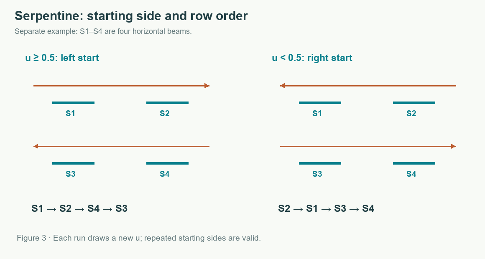
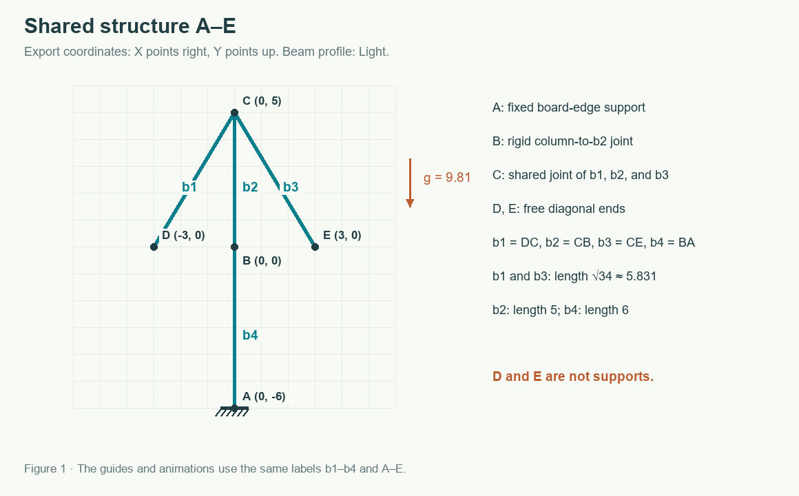
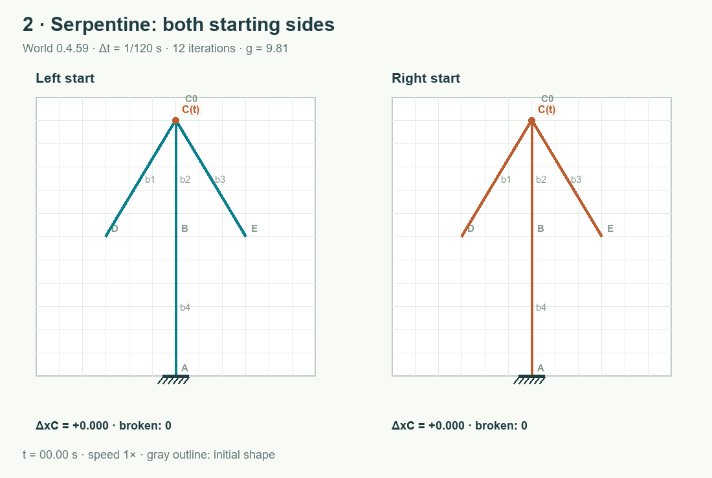

# Serpentine — Random Starting Side and Row-Wise Scan

[All solvers and labels A–E](README.md) · [Basic XPBD Solver](original.md)

Serpentine retains the [Basic XPBD Solver's](original.md) particle model, gravity, local corrections, iteration count, breaking thresholds, and deformation measurements. It changes the order in which members are visited and which beam serves as the reference at a rigid joint. It pseudorandomly chooses a starting side once when a simulation starts.

## 1. An independent 50/50 draw

After confirming that the project contains members, the interface computes:

~~~text
u = Math.random()                 // 0 ≤ u < 1
serpentineFromRight = u < 0.5

0 ≤ u < 0.5  → start on the right
0.5 ≤ u < 1  → start on the left
~~~

The two intervals have equal length, so each side has probability 1/2 under a uniform pseudorandom draw. There is no run counter, remembered previous direction, or forced alternation. For example:

| Successive u values | Starting side for that run |
| ---: | --- |
| 0.75 | Left |
| 0.75 | Left |
| 0.25 | Right |
| 0.50 | Left |
| 0.00 | Right |

Repeated sides are valid. For independent draws, P(Left, Left) = 1/2 × 1/2 = 1/4, and P(next is Left | previous was Left) remains 1/2. A short sequence need not contain equal counts of left and right starts.

The draw occurs only when a nonempty Serpentine simulation starts. Clicking Run on an empty project, pausing and resuming, advancing physics steps, or using another solver does not draw another direction. The worker receives the chosen Boolean and keeps it for the whole run. Supplying the same project and starting side directly to World reproduces the trajectory.

## 2. Order members with a serpentine scan

In the figure, **S1** and **S2** occupy the highest row, while **S3** and **S4** occupy the row one cell below. A left start visits **S1 → S2 → S4 → S3**. A right start visits **S2 → S1 → S3 → S4**. The figure illustrates member selection order, not extra physical constraints.

The implementation does not scan every pixel. It builds a sort key for each member from its initial endpoints in internal coordinates, where X increases rightward and Y downward:

1. y_top is the smallest endpoint Y in the project. For each member, y = min(yA, yB) identifies its highest endpoint.
2. The parity of y − y_top determines whether the row reverses direction. With a left start, the highest row runs left to right and the next row runs right to left.
3. Smaller X comes first in a left-to-right row; larger X comes first in a right-to-left row. For a horizontal beam, the scan uses the endpoint it encounters first.
4. Members sharing a highest point are ordered by the X coordinate of their other endpoint. Original member index breaks any remaining tie.

These are integer rows of the initial board grid. Empty rows still affect parity: skipping two rows keeps the same scan direction. One scan covers the whole project, including disconnected components. Its order is fixed before motion and does not change when the structure leans.

### Worked order for tower b1–b4

Highest point **C** is at internal coordinate (6, 1). **b1**, **b2**, and **b3** all meet there, so C's X coordinate alone cannot order them. Their other endpoints are:

| Beam | Other endpoint | Internal X of other endpoint |
| --- | --- | ---: |
| b1 | D | 3 |
| b2 | B | 6 |
| b3 | E | 9 |

The left-start order is **b1, b2, b3, b4**; the right-start order is **b3, b2, b1, b4**. The highest endpoint of **b4** is **B**, well below C, so b4 comes last from either side.

## 3. Change the reference at joint C

The b1–b3 endpoints at C are separate particles joined by constraints, as described in [Basic XPBD Solver](original.md#1-convert-beams-to-particles-and-constraints). The first beam at C acts as the reference for the other angle constraints.

- With a left start, **b1** is the reference.
- With a right start, **b3** is the reference.

Keeping b1 as the reference for both starts would retain part of the directional preference even after reversing correction order. Serpentine therefore sorts the endpoints within each joint before creating its constraints. It does not change C's position, the joint type, or beam masses.

## 4. Turn member order into constraint order

Each member receives rank 0, 1, … . Its length and internal angle constraints receive that rank as a priority. A constraint joining multiple members uses the earliest rank among the members owning its particles. The distance and angle lists are each stably sorted by priority, preserving creation order within ties.

The 12 iterations still alternate direction: even iterations use the prepared lists, and odd iterations traverse them in reverse. Distances precede angles in every iteration. This changes the schedule of local XPBD corrections throughout the structure; it does not simulate only a subset of beams.

Beam and particle identifiers remain fixed. The renderer still displays b1 as b1 regardless of correction order, and exported JSON retains the same geometry. Reordering JSON rows alone is not equivalent, because import normalizes their order.

## 5. Local calculation and interpretation

The P–Q correction still uses Δλ = (−C − αλ)/(Σ wi |∇i C|² + α). For the Standard segment stretched from 0.5 to 0.51, a single isolated correction gives exactly the same Δλ ≈ −0.004492722 as in [the P–Q example](original.md#3-correct-length-the-pq-example). A difference appears when other constraints move P or Q before or after that correction.

A right-start run is not necessarily the exact mirror image of a left-start run. The scan does not reverse particle indexing within every beam or all other discretization details. Randomizing the starting side distributes the two schedules across runs; it does not remove order dependence or guarantee that the structure stays upright.

## Animation

For a measured comparison of braced and unbraced columns, including the effect of 12 versus 120 iterations, see [Stability, Symmetry, and Iteration Count](stability.md).

The left and right panels are separate runs of the same project, with their starting sides explicitly set for comparison. The app randomly chooses one of these variants for a run.

After 5 s, **C(t)** has ΔxC ≈ −0.332517 with a left start and +0.400614 with a right start. After 10 s, the values are −5.993631 and +5.989180. None of b1–b4 breaks by 12 s. These are measured values from [measurements.json](measurements.json), not a mirrored copy of one animation.

Implementation: [serpentineMemberOrder](../../src/solver-strategies.ts), [joint and constraint construction in World](../../src/physics.ts), and [the one-time draw in the interface](../../src/main.ts). Browser tests use controlled u values to verify a repeated side, the 0.5 threshold, and the absence of extra draws when paused.
