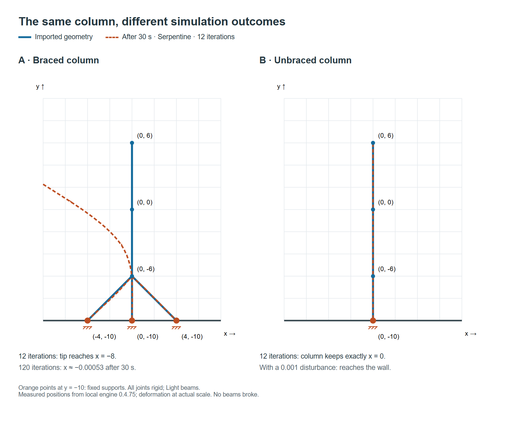

# Stability, Symmetry, and Iteration Count

[All solvers](README.md) · [Basic XPBD Solver](original.md) · [Serpentine](serpentine.md)

A column with diagonal braces can lean over in the simulation while the same column without braces stays perfectly upright. This example exposes two separate effects: insufficient convergence of local corrections in the braced structure, and exact symmetry hiding lateral instability in the unbraced column. It does not show that removing braces improves structural stability.

## Geometry and observed motion



*Blue lines show the imported geometry; dashed orange lines show actual particle positions after 30 seconds with Serpentine, a left start, and 12 iterations per step. Deformation is drawn at its actual scale. Orange points on the bottom boundary are fixed supports. The labels use centered export coordinates, with positive Y upward.*

Both projects use a 16 × 20 board, Light beams, rigid joints, and fixed boundary supports. The column runs from (0, −10) through (0, −6) and (0, 0) to (0, 6). The braced variant adds beams from (−4, −10) to (0, −6), and from (0, −6) to (4, −10). The diagonals are structural members, while their endpoints on the board boundary receive the actual support constraints. No hinge or pinned-support overrides are present.

## Why the braced structure leans

The solver corrects lengths and angles locally, in sequence. Each correction can disturb constraints corrected earlier in the same iteration. With only 12 iterations per physics step, some constraint error remains. In the braced geometry, corrections have horizontal components, and the processing order introduces a small lateral asymmetry that grows under gravity.

Increasing the iteration count to 120 greatly changes the result: the braced column remains almost motionless throughout the 30-second observation. This strong sensitivity to iteration count indicates that the 12-iteration trajectory is materially affected by incomplete convergence. Its direction and timing should not be interpreted as a precise physical stability prediction.

Serpentine's starting side also affects the trajectory. A left start produces a leftward lean in this example; a right start produces a rightward lean. The two trajectories are not exact mirror images. Basic XPBD also develops a lean with 12 iterations, so this behavior is not exclusive to Serpentine.

## Why the unbraced column appears stable

In the unperturbed column, every particle starts on the same vertical line, with zero horizontal velocity. Gravity acts vertically, and the local corrections preserve that alignment: all particles keep export coordinate X = 0. No lateral disturbance initiates the lean.

Remaining upright under these exactly symmetric conditions is not evidence of stability against disturbances. In a separate run, a tiny initial lateral displacement, reaching only 0.001 board units at the tip, causes the unbraced column to lean until it reaches a side wall within 30 seconds. This happens with both 12 and 120 iterations. The increased iteration count alone therefore does not explain the unbraced column's apparent stability; exact alignment also matters.

## Measured comparison

These measurements use the local engine from game version 0.4.75, a fixed step of 1/120 second, and all default physics options except those explicitly listed. Each run advances 3,600 steps. Values below are the top endpoint's centered X coordinate at 30 seconds; the side walls are X = −8 and X = +8.

| Structure | Solver | Starting side | Iterations per step | Tip X after 30 s |
| --- | --- | --- | ---: | ---: |
| Braced | Basic XPBD | — | 12 | −8 |
| Braced | Serpentine | Left | 12 | −8 |
| Braced | Serpentine | Right | 12 | +8 |
| Braced | Serpentine | Left | 120 | approximately −0.000526 |
| Unbraced, exactly aligned | Serpentine | Left or right | 12 | 0 |
| Unbraced, exactly aligned | Serpentine | Left | 120 | 0 |

No beam broke in these runs or in the perturbed-column runs. A large global lean can occur without exceeding the local breaking thresholds.

## Reproducing the comparison

Import either of the following fixtures through `importProject`, then construct `World` with `{ solver: 'serpentine', serpentineFromRight: false, iterations: 12 }`. Advance `world.step()` 3,600 times. Repeat with `iterations: 120`, or set `serpentineFromRight: true` to compare starting sides. For Basic XPBD, use `solver: 'original'`. The 120-iteration setting is a diagnostic option in the physics API; the app's Settings dialog only selects the solver.

Braced project:

```json
{
  "metadata": { "size": [16, 20], "gameVersion": "0.4.75", "formatVersion": 3 },
  "objects": {
    "b": [[-4,-10,0,-6,"l"], [0,6,0,0,"l"], [0,0,0,-6,"l"], [0,-6,0,-10,"l"], [0,-6,4,-10,"l"]]
  },
  "checksum": "fnv1a32:af0aa2aa"
}
```

Unbraced project:

```json
{
  "metadata": { "size": [16, 20], "gameVersion": "0.4.75", "formatVersion": 3 },
  "objects": {
    "b": [[0,6,0,0,"l"], [0,0,0,-6,"l"], [0,-6,0,-10,"l"]]
  },
  "checksum": "fnv1a32:832342db"
}
```

To reproduce the disturbed-column run, apply the following displacement immediately after constructing the unbraced world and before stepping it. Keep all initial velocities at zero.

```typescript
// Internal Y runs downward from 0 to 20. The initial tip is at Y = 4,
// so this linear offset is 0.001 at the tip and zero at the base.
// Visit movable particles only, leaving fixed boundary supports unchanged.
for (let i = 0; i < world.x.length; i++) {
  if (world.invMass[i] > 0) {
    world.x[i] += 0.001 * (20 - world.y[i]) / 16;
  }
}
```

These experiments diagnose sensitivity to numerical convergence and initial disturbances. They do not establish a validated buckling load or prove that 120 iterations are sufficient for every structure.
