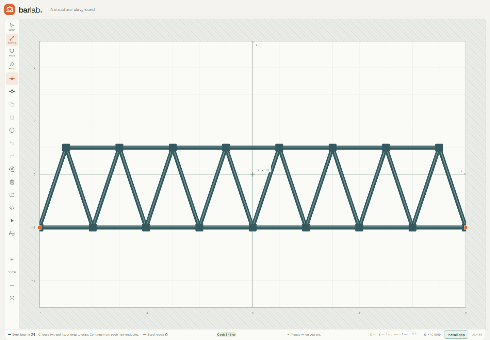
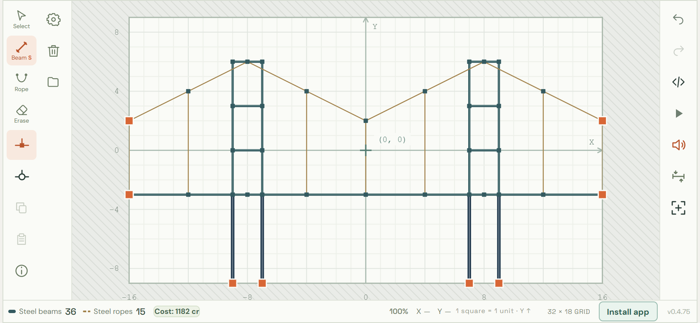
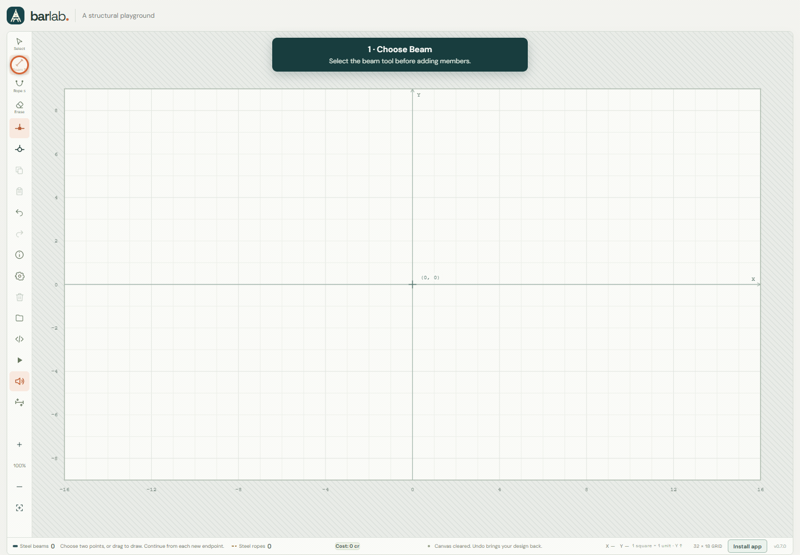
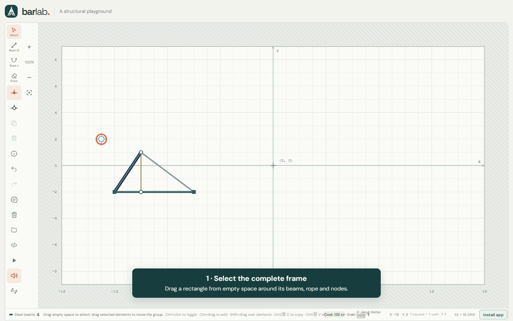
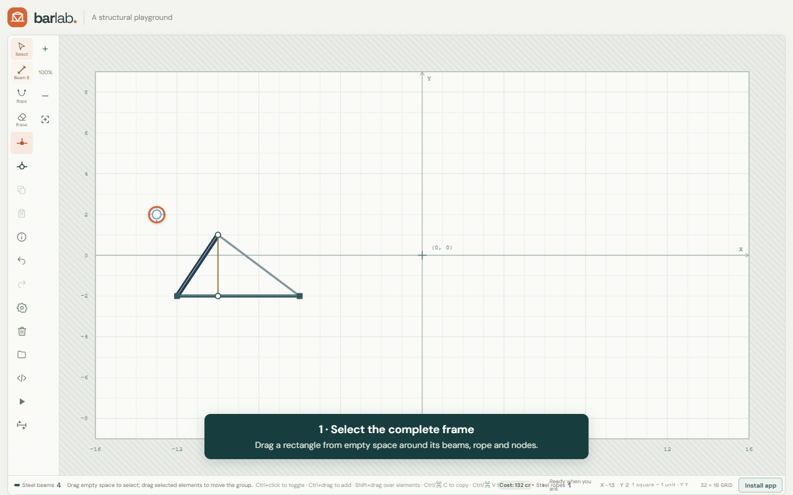

# Player Guide

Play the current version at [barlab.jakubreiter.pl](https://barlab.jakubreiter.pl/). Bar Lab runs in a modern browser; you do not need to download or build the project.

## The workspace

The board is a grid with one unit per square. Its origin `(0, 0)` is at the center; positive X points right and positive Y points up. Orange markers show boundary supports. The starter design uses a 16 × 10 board; built-in examples use their own board dimensions, and the animations below use 32 × 18.

Use the toolbar to choose Select, Beam, Rope or Erase. The inspector shows the current design, beam and rope counts, and cost. Undo and Redo reverse edits. Load an example to explore a ready-made structure, or Clear the canvas to start over.

The examples include Ponte Luís I, the two RTCN Kołowo masts, and Seri Wawasan Bridge. They are simplified 2D interpretations of real landmarks. Ponte Luís I, Kołowo, Golden Gate and the current small Seri Wawasan pass all six 20-second stability checks. Since version 0.5.0, connected members share an exact positional node in both solvers. See the [landmark examples and measured results](examples/README.md).

## Build a structure

1. Choose **Beam** or **Rope**.
2. Click or tap a starting point, then an endpoint. Continue choosing endpoints to draw a chain. On desktop, you can also drag from the start and release at the endpoint; on touch, dragging and releasing also adds an element.
3. Press **Escape**, tap **Cancel**, or change tools to end the chain.

Beams can be up to 6 units long; ropes can be up to 20. A farther target is shortened to a nearby grid point within the limit. The solid blue preview shows the element that will be added; a faint dashed remainder indicates the rest of the pointer's distance. Invalid placements show an explanation.

Follow the highlighted pointer to build a small triangle. Choose **Beam**, click or tap a boundary support to start, then click or tap each next grid point to place a beam and continue the chain. Press `Esc` or tap **Cancel** to finish, then choose **Run** to test the structure.

Choose **Light**, **Standard**, or **Heavy** beside Beam. On desktop, hold the Beam button or press Down to open its profile picker. To change an existing beam, select it and choose a profile in the inspector. Hold **Rope** or press Down on its button to choose **Standard** or **Heavy**. New joints are rigid by default; choose the hinge control before drawing to make new connections hinged.

## Select and edit

- Choose **Select** or press `V`, then click an element to select it. Drag from empty space with the mouse or one finger to draw a selection rectangle. It includes nodes and fully enclosed beams and ropes, in any drawing direction.
- `Ctrl`/`Cmd`+click toggles individual items; `Ctrl`/`Cmd`+drag from empty space adds a rectangle to the selection. `Shift`+drag can start a rectangle over an element, and `Ctrl`/`Cmd`+`Shift`+drag adds it. A short click or tap on empty space clears the selection; cancelling a rectangle restores the earlier selection.
- Drag a selected member or one of its endpoints to move the whole group. A shared node moves only once. Beams and ropes within the group keep their length and orientation; external connections stretch with their moving endpoints. The preview shows cost and any placement error.
- Dragging an unselected node or beam immediately clears the old group and moves only that object. An unselected rope cannot be dragged. Dragging a beam moves both ends together. Cancelling or releasing an invalid move restores the design; a group cleared by an outside grab stays cleared.
- Drop a moving node onto an existing node to merge them. The stationary node keeps its joint and support settings. Existing beam and rope profiles take precedence over exact duplicates. Boundary nodes moved into the interior become ordinary nodes. Bounds and material length limits apply to every affected member; one invalid member blocks the whole move.
- Double-click a node to switch between rigid and hinged connections. On touch, tap the node. Boundary nodes also switch between fixed and pinned supports; use the inspector to edit connection and support settings separately. Right-click an element or selection for its context menu.
- Press `Delete` or `Backspace` to remove the selection. Removing a node also removes connected members; an eligible straight pair of same-profile beams can join into one beam within the length limit. Use Undo to restore the change.
- Use the size control to resize the board. Width must be even and between 12 and 64 units; height must be even and between 8 and 40 units.
- Scroll to zoom. Middle-drag or `Alt`+drag pans the board. Two fingers cancel a pending edit and navigate the view; touch outside the board also pans. Use Fit to bring the board into view.

## Copy and paste a group

1. In **Select**, draw a rectangle around the objects to copy. You can also select members individually or select both endpoint nodes of a connection.
2. Choose **Copy selection** (the overlapping-pages icon), or press `Ctrl`/`Cmd`+`C`. Copy includes selected beams and ropes, connections between explicitly selected nodes, their profiles, and their endpoint settings. An isolated selected node is not copied without a member.
3. Choose **Paste selection** (the clipboard icon), or press `Ctrl`/`Cmd`+`V`. Move the preview to the desired position. The pointer positions the top-left corner of the group's bounding box, snapped to the grid.
4. With a mouse, click to place the copy, or use **Place**. On touch, position the preview with one finger and choose **Place**. **Escape** or **Cancel** discards the preview and restores the earlier selection.
5. Choose **Paste selection** again for another copy. You do not need to copy again: the clipboard keeps the original snapshot even if the source is later edited or removed.

To join copies, align an outer endpoint of the preview with an existing endpoint. The ends merge into one shared node. In this animation, the frame is copied **once** and pasted **twice**: the first copy joins the original's right end, and the second joins the first copy's free right end. Orange rings mark the two shared nodes in the finished structure.

Each completed paste is one Undo step and one automatic save. The new group becomes selected. Exact duplicates retain the existing elements and profiles; a paste consisting entirely of duplicates creates no new history step. Existing nodes keep their connection and support settings. A copied boundary support becomes an ordinary joint when placed inside the board. Partial beam overlaps or out-of-bounds placements block the whole paste and show an explanation. The preview also shows the resulting cost.

The group clipboard belongs to the current page. It supports repeated pastes and survives loading another design in that page, but reloading or closing the page clears it. Use **Project text** to transfer a complete design between devices or browser tabs.

## Paste with a mirror reflection

Start a paste, then choose **Flip left–right** or **Flip up–down** before placing it. Each button toggles its reflection; enable both to combine them. Reflections stay within the group's bounding box, so its placement corner does not shift. Every new paste starts with both reflections off.

This animation copies an asymmetric frame and positions its preview beside the original, then enables **Flip left–right**. The apex, heavy diagonal and vertical rope switch sides. Choosing **Place** creates the mirrored frame and joins its left end to the original's right end.

## Run the simulation

Press **Run** or Space to let gravity act on the design. Beams bend elastically and can break; ropes carry tension but do not push. Use the stress control to color members by relative stress. Press Back to stop and restore the original design. Simulation damage is not saved.

Each run starts with a tiny, repeatable sideways displacement to test how the structure responds to an imperfection. Perfectly straight columns can therefore begin to lean. Supports stay fixed, and your saved design is unchanged.

Open **Settings** (the gear icon) to choose a simulation solver and change the canvas dimensions. Solver choice takes effect immediately and lasts until the page reloads. Canvas dimensions change only when you select **Apply size**; closing Settings discards unsubmitted dimensions. Click **Run simulation** or press Space to start the selected solver directly.

- **1 · Basic XPBD Solver** uses the original XPBD constraint order.
- **2 · Serpentine** is selected on every page load. It visits members from the highest occupied row downward, reversing horizontal direction on each grid row. Each start independently draws top left or top right with equal probability; repeating the same side is possible. Pause/resume keeps the direction of the current run.

## Beam and rope profiles and costs

Costs use exact member lengths and round each material category up once to a whole credit. There is no budget limit. The preview shows the projected change in total cost.

| Material | Mass | Bending stiffness | Axial stiffness | Credits per unit |
| --- | ---: | ---: | ---: | ---: |
| Light beam | 0.5× | 0.25× | 0.5× | 4 |
| Standard beam | 1× | 1× | 1× | 8 |
| Heavy beam | 2× | 4× | 2× | 16 |
| Standard rope | 1× | None | 1× | 2 |
| Heavy rope | 4× | None | 4× | 8 |

Properties are relative to Standard within each material. Heavy ropes model four times the cross-sectional area, with twice the visible diameter, four times the mass and axial rigidity, and the same failure strain. Both rope types carry tension only. A heavier cable can increase the load on a weak tower, so upgrading every rope does not guarantee stability.

Hold **Rope**, right-click it, or focus it and press Down to choose Standard or Heavy, just like the Beam menu. Each tool remembers its own choice. Select only ropes to change their profile together; a mixed profile selection shows **Mixed**. Profile edits support Undo and Redo.

 All beam profiles have the same 6-unit length limit; ropes allow 20 units. Splitting a beam does not change its category cost.

## Save and share designs

The latest design is saved automatically in this browser and restored on the next visit. Browser storage is separate per device and browser, and clearing site data removes the saved design. Use **Project text** to copy a backup or move a design to another device. Importing project text replaces the current design only when the text is valid; successful imports can be undone.

Project text is JSON, format version 4. Coordinates are measured from the board center, with positive Y pointing up. Beam and rope entries contain four coordinates followed by their profile. Ropes use `s` (Standard) or `h` (Heavy). Format 3 projects remain importable: their coordinate-only rope entries become Standard ropes. New exports use format 4 and contain the original design, not simulation damage or prices; older app releases cannot open the new format.

## Install and play offline

Open the public HTTPS site while online and wait for **Game files are ready offline**. The first visit must finish loading before the app can work offline. When an update is ready, choose **Update ready · Reload**.

Choose **Install app** in the status bar for device-specific steps. Supported browsers may offer an install prompt; otherwise the app explains the browser menu path. On iPhone or iPad, use Safari's Share menu and **Add to Home Screen**. Open the installed app once while online and wait for the offline-ready message. An installed app may have separate saved projects from the browser tab.
